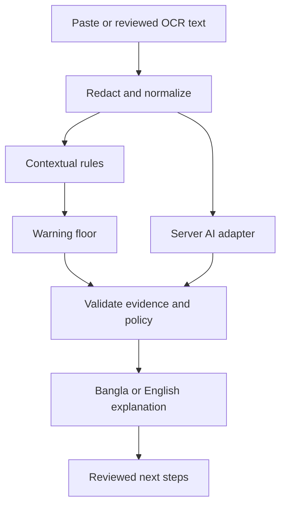

# Scam Message Explainer

A Bangla-first B2C SaaS that helps people understand suspicious SMS, email and chat requests, recognize warning signs, and choose the next action after a mistake.

**Status: specification and Codex bootstrap kit. Application code has not been implemented by these files.** No accuracy, payment integration, users, subscriptions or production deployment is claimed.

## Product promise

Paste a suspicious message and receive:

1. Highlighted warning signs with short explanations in Bangla or English.
2. One conservative verdict: **strong warning**, **some warning**, or **cannot tell**.
3. A clear immediate action and an exposure-based recovery checklist.

Later releases add browser-only screenshot OCR, paid access and voluntary family help. The product never certifies a message safe, authenticates a sender from a screenshot, opens suspicious links or guarantees recovered money.

## B2C launch scope

| First release | After the core works | Later, after validation |
|---|---|---|
| Mobile web text check | Browser screenshot OCR and text review | Voluntary family membership/sharing |
| Bangla/English output, Banglish input | Email login, quotas and account page | Better on-device processing and explicit share target |
| Context-aware rules plus validated AI | Approved prepaid checkout | Reviewed scam-spotting exercises |
| Free recovery guidance | Paid-user onboarding and billing support | Native app/bot only if users need it |

Keep the first product focused on local bank/MFS impersonation, bonus/benefit lures, loan advances, job/task deposits and suspicious shopping requests. Include genuine promotions, OTP notifications and security warnings in evaluation.

## Stack

| Layer | Choice |
|---|---|
| Application | Next.js App Router, React, TypeScript |
| UI | Tailwind CSS, shadcn/ui, accessible native form controls |
| Language | next-intl, Bangla default and English toggle |
| Data/auth | Supabase Postgres, Auth, SQL migrations and RLS |
| Analysis | Plain TypeScript rules/policy engine, Zod, official Google GenAI SDK on the server |
| Screenshots | Tesseract.js in a browser worker; user reviews/redacts extracted text before remote analysis |
| Abuse/quotas | Cloudflare Turnstile, signed guest session, atomic Postgres reservations and limits |
| Email | Custom SMTP through Supabase, initially Resend subject to account/domain setup |
| Payments | Adapter: SSLCOMMERZ after merchant approval; bKash direct integration only if commercially justified |
| Hosting | Vercel commercial-use plan; Supabase managed project |
| Quality | Vitest, Testing Library, Playwright, GitHub Actions |

See [TECH_STACK.md](TECH_STACK.md) for architecture, tradeoffs, data contracts, deployment and official references.

## Business model to validate

Proposed pricing experiments, **not validated demand or configured products**:

| Plan | Initial experiment |
|---|---|
| Free | Rules and recovery guidance remain available; limited remote AI checks |
| Pro | BDT 99 for a user-initiated 30-day access period; bounded AI quota and screenshot convenience |
| Family | Later experiment: BDT 199 per 30-day period, up to five consenting members sharing a quota |

Start with prepaid access, not assumed automatic recurring billing. Set quotas from measured cost and user behavior before charging. Explain the access expiry and renewal clearly. Paid access does not include managed recovery, legal representation, guaranteed detection or insurance.

## Repository contents now

```text
AGENTS.md             product-specific instructions Codex reads
README.md             product, status and how to start
TECH_STACK.md         architecture and production decisions
CODEX_TASKS.md        sequential build tasks and acceptance criteria
.env.example         placeholder configuration contract
.gitignore           intended local/secrets exclusions
```

These are planning files. Future source directories and scripts appear when Task 1 is implemented.

## Start with Codex Cloud

1. Create a GitHub repository, preferably private while validating the product.
2. Upload this kit's contents to the repository root. Keep the filename **AGENTS.md**, plural and uppercase. It is intentionally not `Agent.md`.
3. Open Codex Cloud and select/connect that repository. Configure a cloud environment using the current environment interface available to your account.
4. Ask Codex to implement **Task 1 only** from [CODEX_TASKS.md](CODEX_TASKS.md). Begin with deterministic mock AI/data/auth and disabled billing. No API key is required for that milestone.
5. Review the code, run the documented checks, and merge the bootstrap before starting the rules/AI/account/billing tasks.
6. Use separate preview and production configuration. Keep production customer data, provider secrets and live payment access out of ordinary coding tasks.

Current Codex documentation describes published environments, install scripts, start instructions and domain-scoped HTTP secrets. Older Cloud environments have different setup/secret behavior. Follow the matching section in [TECH_STACK.md](TECH_STACK.md), not assumptions copied from an older tutorial.

### First task prompt

```text
Read AGENTS.md, README.md, TECH_STACK.md and Task 1 in CODEX_TASKS.md.
Inspect the repository, then implement Task 1 only.
Build a mobile-first Next.js App Router app with TypeScript, Tailwind,
shadcn/ui and Bangla/English messages. Use deterministic mock adapters,
no paid APIs or external database, and disabled billing.
Preserve these documents and any useful framework-generated instructions.
Implement the required check scripts, run them, and report actual results.
Do not deploy, activate payments or claim the mock checker is live AI.
```

## Local development after bootstrap

The following workflow becomes available **after Task 1 creates package.json and the lockfile**:

```bash
pnpm install --frozen-lockfile
cp .env.example .env.local
pnpm dev
```

Use Node.js 24 LTS and the exact pnpm version recorded by bootstrap. Development defaults must allow the app and mock tests to run without Supabase, Gemini, a payment account or Docker. Do not run `create-next-app` blindly in a non-empty repository; Task 1 explains safe scaffolding.

Expected checks after bootstrap:

```bash
pnpm verify
pnpm test:e2e
```

The database integration suite is separate and needs local or ephemeral Supabase:

```bash
pnpm test:db
```

Do not label skipped integration tests successful. Default CI must not make paid API calls.

## Analysis flow



AI does not control the final policy. It can suggest a stronger warning only with supported evidence. A timeout or invalid output preserves the deterministic warning and explains that deeper analysis was unavailable.

## Privacy and product constraints

- No raw message, screenshot, OCR text or result history stored by default.
- Browser-only OCR in the initial image release; original screenshots are not uploaded.
- No user-message bodies, prompts or credentials in analytics or logs.
- No automatic links, previews or remote inspection of a suspect URL.
- No public blacklist or claim that a phone-number owner is a criminal.
- No reuse for training without separate lawful rights and consent.
- No automatic family access to another member's messages.
- Public recovery help remains available without payment or an account.

Client-side redaction is a precaution, not a guarantee of anonymity. A remote AI check sends the reviewed redacted text to the configured provider. Production requires a clear privacy notice, appropriate vendor terms and a Bangladesh legal review of applicable data handling and payments.

## Payments and authorization

Payment integration is **disabled initially**. A sandbox demonstration is not live merchant approval.

Access is granted only after a server verifies the provider's successful transaction and matches the stored order, user, amount and currency. Return URLs, frontend success states and duplicate callbacks must never create or extend entitlements by themselves. Clients cannot write payment or usage-credit records directly.

For production, configure hosted checkout, authenticated callbacks/status verification, refunds, cancellation/expiry behavior and reconciliation. Confirm SaaS eligibility and fees directly with the payment provider. Do not assume Stripe is available to a Bangladesh entity or recurring charging is enabled by a generic checkout.

## Launch checklist

- [ ] Real rules handle genuine “never share OTP” warnings correctly.
- [ ] Rule floors survive AI failure, prompt injection and malformed outputs.
- [ ] Bangla/Banglish/English held-out results and uncertainty are documented.
- [ ] Cross-user isolation, atomic quota use and payment idempotency are tested.
- [ ] Abuse controls and hard AI-spend caps are active before public AI access.
- [ ] Custom SMTP and auth redirects work for real external test users.
- [ ] No raw content appears in application/platform logs or telemetry.
- [ ] Official recovery routes are verified and dated.
- [ ] Commercial hosting, model terms, privacy notice and payment eligibility are reviewed.
- [ ] Real billing is enabled only after approved end-to-end testing.

## Contributing and status updates

Read [AGENTS.md](AGENTS.md). Work one milestone at a time, keep changes reviewable and update this README's status when working features ship. Do not add badges, evaluation scores, partner logos or customer testimonials without evidence.

## License

No application license has been selected. The founder must choose one before accepting external contributions or publishing the application under open-source terms. Public availability is not permission to use noncommercial research datasets in a commercial product.
